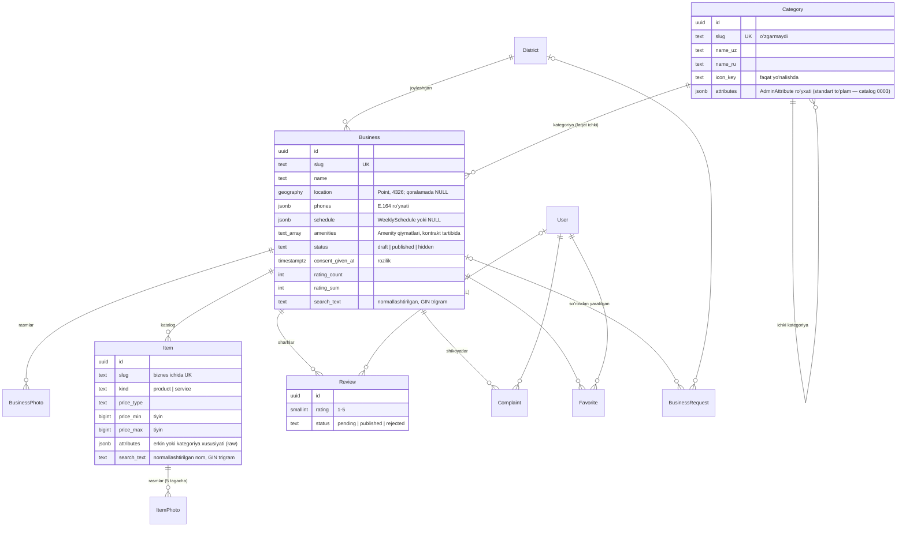

# Backend maʼlumot modeli

PostgreSQL 17 + PostGIS. Barcha ID'lar — UUID (kontraktdagidek), pul — tiyinda `bigint`, vaqt — `timestamptz`, ish vaqti — Asia/Tashkent (ADR-0010). Administratorlar, rollar, audit (3.5), statistika va hisobot havolalari (3.8) keyingi qadamlarda qoʻshiladi.

## Maʼlumotlar bazasi darajasidagi kafolatlar

API'ni chetlab oʻtgan kod (skript, migratsiya, xato) ham quyidagilarni buzolmaydi:

| Cheklov                                                       | Maʼnosi                                                                        |
| ------------------------------------------------------------- | ------------------------------------------------------------------------------ |
| `business_published_requirements`                             | Eʼlon qilingan biznesda joylashuv, manzil va egasining roziligi bor (ADR-0007) |
| `business_consent_has_author`                                 | Rozilik qayd etilgan boʻlsa — kim berganligi ham                               |
| `business_rating_sum_range`                                   | Reyting yigʻindisi `count … 5·count` oraligʻida                                |
| `category_root_has_icon`                                      | Yoʻnalishda ikonka bor                                                         |
| `item_price_consistent`                                       | Narx turi va qiymatlari mos (`NULL` holatlari ham aniq tekshiriladi)           |
| `item_duration_only_for_services`                             | Davomiylik faqat xizmatlarda, 5–1440 daqiqa                                    |
| `item_business_slug`                                          | Mahsulot slug'i biznes ichida yagona                                           |
| `review_one_per_user`                                         | Bir foydalanuvchi — bir biznesga bitta sharh                                   |
| `review_rating`, `review_rejected_has_reason`                 | Baho 1–5; rad etilgan sharhda sabab bor                                        |
| `complaint_other_has_text`, `complaint_closed_has_note`       | "Boshqa" sababida izoh; yopilgan shikoyatda javob                              |
| `request_converted_has_business`, `request_rejected_has_note` | Soʻrov holati qoidalari                                                        |
| `user_provider_uid`, `user_blocked_has_reason`                | Bir provayder hisobi — bitta foydalanuvchi; bloklashda sabab                   |
| `admin_single_root`, `admin_root_active`                      | Root faqat bitta va uni oʻchirib (bloklab) boʻlmaydi                           |
| `admin_username_format`                                       | Login: `^[a-z][a-z0-9_.-]{2,31}$` (kontraktdagi bilan bir xil)                 |
| Trigger `staff_auditentry_no_update_delete`, `…_no_truncate`  | Audit jurnali faqat qoʻshiladi: UPDATE, DELETE, TRUNCATE rad etiladi           |
| `platform_settings_singleton`                                 | Sozlamalar — bitta yozuv                                                       |

## Oʻchirish qoidalari

| Oʻchiriladi       | Natija                                                                                                                                                                 |
| ----------------- | ---------------------------------------------------------------------------------------------------------------------------------------------------------------------- |
| Foydalanuvchi     | Sharhlari muallifsiz qoladi (`SET NULL` → "Oʻchirilgan foydalanuvchi"), shikoyat va sevimlilari oʻchadi. Moderatsiyadagi sharhlarni oʻchirish — servis qatlamida (3.4) |
| Biznes            | Rasmlar, katalog, sharhlar, shikoyatlar, sevimlilar bilan (`CASCADE`); soʻrovdagi havola `NULL`                                                                        |
| Kategoriya, tuman | Bogʻlangan biznes boʻlsa — taqiqlangan (`PROTECT`)                                                                                                                     |
| Administrator     | Audit jurnalida yozuvi boʻlsa — taqiqlangan (`PROTECT`); administrator faqat oʻchiriladi (`is_active=false`). Sessiyalari va kirish challenge'lari — `CASCADE`         |
| Biznes rasmi      | Yozuv bilan birga fayl ham oʻchadi (tranzaksiya muvaffaqiyatli yakunlangach)                                                                                           |
| Mahsulot, rasmi   | Mahsulot rasmlari bilan (`CASCADE`); fayllar tranzaksiyadan keyin oʻchadi — biznes qoralamasi oʻchirilganda ham                                                        |

## Administratorlar (3.5)

`apps/staff`: `AdminUser` (parol — Argon2 xeshi; TOTP kaliti — Fernet bilan shifrlangan; `must_change_password`; `totp_last_step` — kodni qayta ishlatishga qarshi), `Role` (ruxsatlar roʻyxati, tizim rollari `is_built_in`), `AdminUser.roles` (M2M) va `extra_permissions`, `AdminSession` (token — faqat SHA-256 xeshi, 8 soat), `LoginChallenge` (5 daqiqa; sozlashda yangi parol va kalit shu yerda kutadi), `AuditEntry` (faqat qoʻshiladi). Ruxsatlar roʻyxati — `apps/staff/permissions.py`, kontraktdagi `AdminPermission` bilan bir xil (test).

## Statistika va hisobot havolasi (3.8)

`DailyStats` — biznes va Toshkent sanasi boʻyicha kunlik hisoblagichlar (faqat sonlar). `ReportLink` — biznesga bitta havola: token (~256 bit) bir marta koʻrsatiladi, bazada SHA-256 xeshi; yangisi eskisini almashtiradi; ochilishlar soni va oxirgi vaqt. Biznes oʻchirilsa — ikkalasi ham (`CASCADE`).

## Slug qoidalari

- Biznes slug'i nomdan yaratiladi (kirill lotinga oʻgiriladi), butun platformada noyob (`-2`, `-3` …). Nom oʻzgarsa, slug faqat biznes hali hech qachon eʼlon qilinmagan boʻlsa (`published_at` boʻsh) yangilanadi — eʼlon qilingan sahifa manzili barqaror.
- Mahsulot slug'i biznes ichida noyob va tahrirda oʻzgarmaydi.

## Qidiruv

`search_text` — biznes nomi, kategoriya va ota-kategoriya (ikkala tilda), tuman nomlari, katalogdagi mahsulot nomlari va boʻlimlarining normallashtirilgan matni (ADR-0014; mahsulot qoʻshilganda, oʻzgarganda va oʻchirilganda qayta hisoblanadi) (`apps/core/text.py`, frontend `normalize.ts` bilan bir xil). Indeks — GIN `gin_trgm_ops`: aniq qism (`icontains`) va imlo xatolariga chidamli oʻxshashlik (`trigram_word_similar`). Kategoriya nomi oʻzgarganda oʻzi va ichki kategoriyalaridagi bizneslarning `search_text`i yangilanadi (3.7). Tumanlar API orqali oʻzgartirilmaydi.

## Kontrakt bilan moslik

| Kontrakt                                        | Model                                                              |
| ----------------------------------------------- | ------------------------------------------------------------------ |
| `BusinessDetail.rating`                         | `rating_sum / rating_count` (sharhlar moderatsiyasida yangilanadi) |
| `BusinessSummary.priceRange`                    | Katalogdagi narxlardan hisoblanadi                                 |
| `coverImage`, `gallery`, `AdminBusiness.photos` | `BusinessPhoto` (birinchisi — muqova)                              |
| `Consent`                                       | `consent_given_by / _at / _note`                                   |
| `Review.authorName`                             | `User.display_name` qisqartmasi yoki "Oʻchirilgan foydalanuvchi"   |
| `Item.images`, `AdminItem.photos`               | `ItemPhoto` (birinchisi — asosiy; ADR-0014)                        |
| `Item.attributes`, `AdminItem.attributeValues`  | `Item.attributes` + kategoriya taʼriflari (`attributes.py`)        |
| `BusinessSummary.matchedItems`                  | `Item.search_text` — sahifadagi bizneslar uchun bitta soʻrov       |
