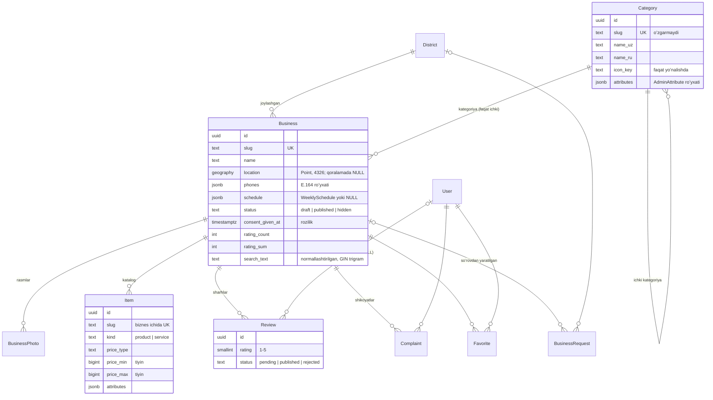

# Backend maʼlumot modeli

PostgreSQL 17 + PostGIS. Barcha ID'lar — UUID (kontraktdagidek), pul — tiyinda `bigint`, vaqt — `timestamptz`, ish vaqti — Asia/Tashkent (ADR-0010). Administratorlar, rollar, audit (3.5), statistika va hisobot havolalari (3.8) keyingi qadamlarda qoʻshiladi.

## Maʼlumotlar bazasi darajasidagi kafolatlar

API'ni chetlab oʻtgan kod (skript, migratsiya, xato) ham quyidagilarni buzolmaydi:

| Cheklov                                                       | Maʼnosi                                                                        |
| ------------------------------------------------------------- | ------------------------------------------------------------------------------ |
| `business_published_requirements`                             | Eʼlon qilingan biznesda joylashuv, manzil va egasining roziligi bor (ADR-0007) |
| `business_consent_has_author`                                 | Rozilik qayd etilgan boʻlsa — kim berganligi ham                               |
| `business_rating_sum_range`                                   | Reyting yigʻindisi `count … 5·count` oraligʻida                                |
| `category_root_has_icon`                                      | Yoʻnalishda ikonka bor                                                         |
| `item_price_consistent`                                       | Narx turi va qiymatlari mos (`NULL` holatlari ham aniq tekshiriladi)           |
| `item_duration_only_for_services`                             | Davomiylik faqat xizmatlarda, 5–1440 daqiqa                                    |
| `item_business_slug`                                          | Mahsulot slug'i biznes ichida yagona                                           |
| `review_one_per_user`                                         | Bir foydalanuvchi — bir biznesga bitta sharh                                   |
| `review_rating`, `review_rejected_has_reason`                 | Baho 1–5; rad etilgan sharhda sabab bor                                        |
| `complaint_other_has_text`, `complaint_closed_has_note`       | "Boshqa" sababida izoh; yopilgan shikoyatda javob                              |
| `request_converted_has_business`, `request_rejected_has_note` | Soʻrov holati qoidalari                                                        |
| `user_provider_uid`, `user_blocked_has_reason`                | Bir provayder hisobi — bitta foydalanuvchi; bloklashda sabab                   |
| `platform_settings_singleton`                                 | Sozlamalar — bitta yozuv                                                       |

## Oʻchirish qoidalari

| Oʻchiriladi       | Natija                                                                                                                                                                 |
| ----------------- | ---------------------------------------------------------------------------------------------------------------------------------------------------------------------- |
| Foydalanuvchi     | Sharhlari muallifsiz qoladi (`SET NULL` → "Oʻchirilgan foydalanuvchi"), shikoyat va sevimlilari oʻchadi. Moderatsiyadagi sharhlarni oʻchirish — servis qatlamida (3.4) |
| Biznes            | Rasmlar, katalog, sharhlar, shikoyatlar, sevimlilar bilan (`CASCADE`); soʻrovdagi havola `NULL`                                                                        |
| Kategoriya, tuman | Bogʻlangan biznes boʻlsa — taqiqlangan (`PROTECT`)                                                                                                                     |

## Qidiruv

`search_text` — biznes nomi, kategoriya va ota-kategoriya (ikkala tilda), tuman nomlarining normallashtirilgan matni (`apps/core/text.py`, frontend `normalize.ts` bilan bir xil). Indeks — GIN `gin_trgm_ops`: aniq qism (`icontains`) va imlo xatolariga chidamli oʻxshashlik (`trigram_word_similar`). Kategoriya yoki tuman nomi oʻzgarganda bogʻliq bizneslarning `search_text`i yangilanadi (3.7).

## Kontrakt bilan moslik

| Kontrakt                                        | Model                                                              |
| ----------------------------------------------- | ------------------------------------------------------------------ |
| `BusinessDetail.rating`                         | `rating_sum / rating_count` (sharhlar moderatsiyasida yangilanadi) |
| `BusinessSummary.priceRange`                    | Katalogdagi narxlardan hisoblanadi                                 |
| `coverImage`, `gallery`, `AdminBusiness.photos` | `BusinessPhoto` (birinchisi — muqova)                              |
| `Consent`                                       | `consent_given_by / _at / _note`                                   |
| `Review.authorName`                             | `User.display_name` qisqartmasi yoki "Oʻchirilgan foydalanuvchi"   |
| `Item.images`                                   | Hozircha boʻsh roʻyxat (mahsulot rasmlari MVP'da yoʻq)             |
